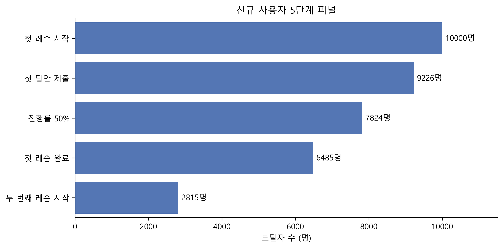
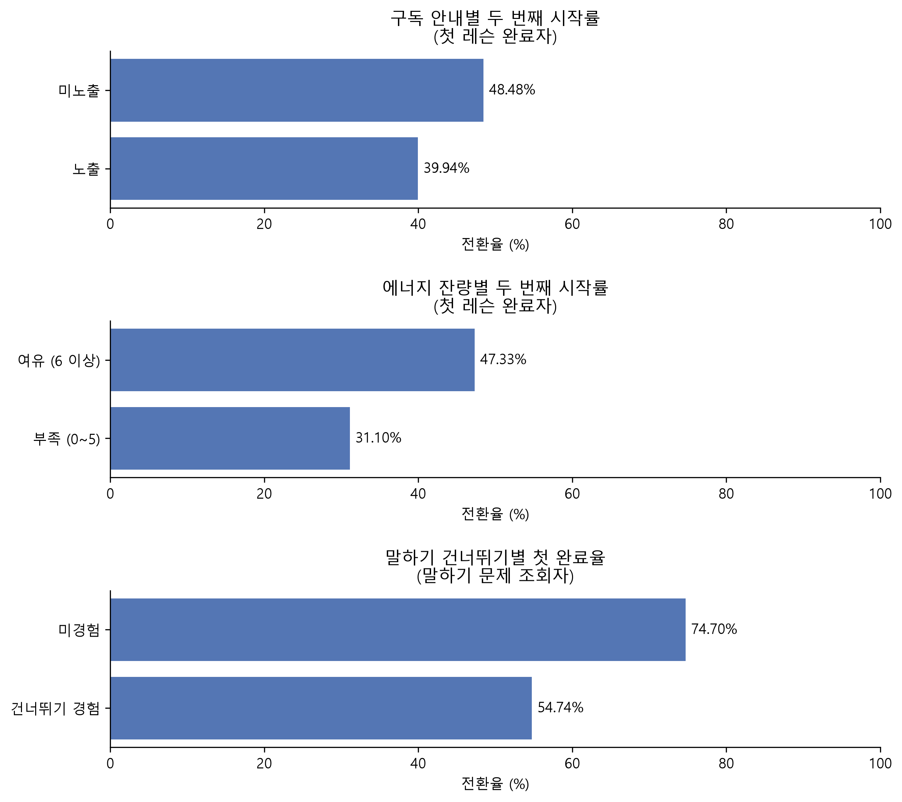

# 듀오링고 신규 사용자 퍼널 분석 및 학습 전환 개선안

*가상 데이터 기반 첫 레슨 이탈과 후속 학습 미진행 분석*

본 프로젝트에서는 듀오링고 신규 사용자의 첫 레슨 이탈과 후속 학습 미진행을 진단하고 개선안을 제안하였다. 신규 사용자 10,000명의 정보와 행동 로그로 구성된 가상 데이터로 5단계 퍼널을 분석하였다. 사용자를 중복 없이 집계하고, 첫 완료는 시작 후 24시간, 두 번째 시작은 첫 완료 후 7일 이내를 기준으로 삼았다.

## 1. 핵심 문제

첫 레슨 시작자 10,000명 중 64.85%가 완료하였고, 35.15%은 24시간 내 완료하지 못하였다. 완료자 중 7일 내 두 번째 시작자는 43.41%이었으며, 56.59%은 시작하지 않았다. 전체 시작자 대비 두 번째 레슨 도달률은 28.15%였다. 단계 이탈률과 이탈 인원이 가장 큰 완료 후 미진행 구간을 우선 개선 과제로 선정하였다.

| 구간 | 전환율 | 이탈률 | 이탈자 수 |
| --- | ---: | ---: | ---: |
| 첫 시작 → 첫 답안 제출 | 92.26% | 7.74% | 774명 |
| 첫 답안 제출 → 50% 도달 | 84.80% | 15.20% | 1,402명 |
| 50% 도달 → 첫 완료 | 82.89% | 17.11% | 1,339명 |
| **첫 완료 → 두 번째 시작** | **43.41%** | **56.59%** | **3,670명** |

*전환율과 이탈률은 직전 단계 사용자 수를 기준으로 계산하였다.*

첫 완료자 중 구독 안내 노출 집단의 후속 시작률은 39.94%로 미노출 집단의 48.48%보다 낮았다. 에너지가 0~5인 집단도 31.10%로, 6 이상인 집단의 47.33%보다 낮았다. 말하기 문제 조회자 내에서는 건너뛰기 경험자의 첫 완료율이 54.74%로, 미경험자의 74.70%보다 낮았다.

## 2. 개선안

구독 안내를 두 번째 레슨 완료 이후로 미루어 다음 학습으로 이어지는 흐름을 지원하는 방안을 제안한다. 에너지가 부족한 완료자에게는 추가 보상을 제공하고, 말하기가 어려운 상황에서는 같은 학습 목표의 대체 문제를 쉽게 선택하도록 한다. 구독 안내와 에너지 지원은 후속 시작률, 말하기 대체 문제는 첫 완료율 개선을 목표로 한다.

| 구분 | 분석 근거 | 개선안 |
| --- | --- | --- |
| 구독 안내 | 두 번째 시작률: 노출 39.94% / 미노출 48.48% | 안내 시점을 두 번째 레슨 완료 이후로 조정 |
| 에너지 부족 | 두 번째 시작률: 0~5인 집단 31.10% / 6 이상인 집단 47.33% | 에너지 부족 완료자에게 추가 에너지 보상 제공 |
| 말하기 건너뛰기 | 첫 완료율: 경험자 54.74% / 미경험자 74.70% | 같은 학습 목표의 대체 문제 제공 |

*구독·에너지는 첫 완료자, 말하기는 말하기 문제 조회자 내 비교이다.*

개선 규모는 시작률이 +1·+3·+5%p 높아지는 상황을 가정하여 계산하였다. 전체 완료자 6,485명에서 +5%p를 적용하면 추가 시작자는 약 324명이며, 에너지 부족자 1,566명에 한정하면 약 78명이다. 두 집단이 겹치므로 합산하지 않으며, 가정에 따른 규모 예시로 해석한다.

| 개선폭 가정 | 전체 완료자 대상 추가 시작자 | 에너지 부족자 대상 추가 시작자 |
| --- | ---: | ---: |
| +1%p | 65명 | 16명 |
| +3%p | 195명 | 47명 |
| +5%p | 324명 | 78명 |

## 3. 결론

첫 레슨 완료 후 미진행 구간을 우선 개선 과제로 선정하였다. 구독 안내 시점 조정과 에너지 지원을 주요 개선안으로 제안하며, 말하기 대체 문제를 통한 학습 편의성 개선도 함께 검토한다. 가상 데이터에서 관찰한 관계만으로 실제 서비스의 개선 효과를 입증할 수는 없다. 향후 실제 데이터를 활용해 같은 양상이 나타나는지 확인하고, 개선안의 적용 가능성을 검토할 필요가 있다. 실제 효과를 검증하기 위한 A/B 테스트는 후속 과제로 남긴다.
